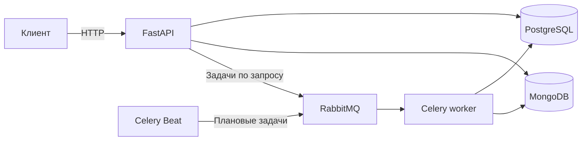

# Feature Flag Service

__Feature Flag Service__ ~ это pet-проект Python-бэкенда для управления доступом к новым
функциям после релиза. Приложение спрашивает сервис, какую версию функции
показать конкретному пользователю. Команда может менять это решение без
повторного развёртывания приложения.

Например, интернет-магазин может открыть новую форму оплаты для 10%
подходящих пользователей. Затем команда может сравнить старую и новую формы
в A/B-эксперименте и проверить, в какой группе чаще завершают покупку.

## Возможности:

- Включать и выключать функции, выбирать аудиторию по атрибутам и постепенно
  расширять доступ через процентный rollout.
- Назначать варианты A/B-эксперимента, собирать показы и целевые события,
  сравнивать конверсию и оценивать статистическую значимость.
- Получать шаблонный отчёт сразу по сохранённым результатам или запрашивать
  фоновый LLM-отчёт с пояснением метрик и возможными рекомендациями.

## Стек технологий и инструментов:

| __Область__                | __Технологии и их роль__                                                                                                                             |
|----------------------------|------------------------------------------------------------------------------------------------------------------------------------------------------|
| __API__                    | Python 3.12+, FastAPI и Uvicorn для HTTP API, Pydantic для валидации данных и настроек.                                                              |
| __Хранение данных__        | PostgreSQL 16 для настроек и результатов, SQLAlchemy и asyncpg для доступа к нему, Alembic для миграций. MongoDB 4.4 и PyMongo для хранения событий. |
| __Фоновые задачи__         | RabbitMQ 3 для очередей, Celery worker для выполнения задач, Celery Beat для их запуска по расписанию.                                               |
| __Аналитика и отчёты__     | NumPy для статистических расчётов, HTTPX для вызовов совместимого Chat Completions API.                                                              |
| __Разработка и проверки__  | uv для установки зависимостей, pytest и pytest-asyncio для тестов, coverage.py для замеров покрытия, GitHub Actions для CI.                          |
| __Запуск и развёртывание__ | Docker и Docker Compose для локального стека, Kubernetes и minikube для локального развёртывания в кластере.                                         |

Redis входит в Compose-конфигурацию. Его текущая роль описана в
[руководстве по архитектуре](docs/architecture.md#компоненты).

## Архитектура



FastAPI принимает запросы. PostgreSQL хранит настройки флагов, эксперименты,
результаты и отчёты. MongoDB хранит показы и другие события. RabbitMQ
передаёт задачи воркеру Celery, а Beat публикует плановые задачи, например
пересчёт статистики. Подробнее в [описании архитектуры](docs/architecture.md).

## Локальный запуск в Docker Compose

Нужен запущенный Docker с поддержкой Docker Compose. Выполните команды
из корня клонированного репозитория в PowerShell 7.

```powershell
docker compose up --build -d
docker compose ps -a
```

Одноразовый сервис `init` применяет миграции PostgreSQL и создаёт индексы MongoDB.
Код выхода `0` для него означает успешное завершение. После инициализации
запускаются API, Celery worker и Beat. Когда API станет `healthy`, проверьте
готовность.

```powershell
$api = 'http://127.0.0.1:8000'
Invoke-RestMethod "$api/api/health/ready" | ConvertTo-Json
```

Ожидается HTTP `200` и `ok` для PostgreSQL и MongoDB. Откройте
[Swagger UI](http://127.0.0.1:8000/docs) или [ReDoc](http://127.0.0.1:8000/redoc),
чтобы посмотреть контракт API.

Настройка портов и окружения, назначение первого администратора и запуск Python
через `uv` описаны в [руководстве по запуску](docs/getting-started.md).
Команда `docker compose down` останавливает стек и сохраняет данные в томах.

## Демонстрация

[Пройти A/B-эксперимент](docs/demo.md) — создать флаг, запустить эксперимент,
назначить варианты через `/resolve`, отправить конверсии, пересчитать
результаты и получить шаблонный отчёт. Сценарий работает без ключа LLM.

## Подключение LLM

`GET /api/experiments/{experiment_id}/template/reports` возвращает шаблон сразу.
Каждый вызов формирует его по последнему сохранённому снимку без расхода токенов.
`POST /api/experiments/{experiment_id}/llm/reports` ставит задачу в очередь.
Результат доступен в истории отчётов. При сбое генерации сервис сохраняет
шаблон с указанием причины.

Клиент отправляет `POST` на `/v1/chat/completions` с Bearer-токеном и полями
`model`, `messages`, `stream: false` и `max_completion_tokens`. Он ожидает
непустой текст в `choices[0].message.content` и значение `stop` в
`choices[0].finish_reason`. Этот контракт проверен с Atria-Dawn. Если другой
провайдер использует несовместимый формат или протокол, понадобится адаптер.
Лимит генерации задаётся через `LLM_MAX_OUTPUT_TOKENS` и по умолчанию равен
`1100`. Расход токенов зависит также от входных сообщений и повторных вызовов.

## Руководства:

- [Запуск](docs/getting-started.md) ~ настроить Compose или Python-окружение и назначить администратора.
- [Архитектура](docs/architecture.md) ~ разобраться в компонентах и потоках данных.
- [API](docs/api.md) ~ найти маршруты, правила доступа, фильтры и примеры запросов.
- [Модель данных](docs/data-model.md) ~ посмотреть схему PostgreSQL, документы и индексы MongoDB.
- [Feature-флаги](docs/feature-flags.md) ~ настроить таргетинг и rollout и понять решение `/resolve`.
- [Эксперименты](docs/experiments.md) ~ связать показы с конверсиями, интерпретировать результаты и запросить отчёт.
- [Эксплуатация](docs/operations.md) ~ проверить очереди, метрики и логи и диагностировать сбои.
- [Тестирование](docs/testing.md) ~ запустить тесты, узнать, что они проверяют, и воспроизвести замер покрытия.
- [Kubernetes](k8s/README.md) ~ развернуть сервис в minikube.
