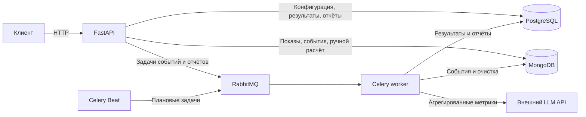

# Архитектура Feature Flag Service

Сервис объединяет управление feature-флагами, назначение вариантов A/B, приём событий и подготовку отчётов. HTTP API обрабатывает интерактивные операции. Celery выполняет задачи, которые можно завершить после ответа клиенту или запускать по расписанию.

## Компоненты



| __Компонент__                        | __Ответственность__                                                                                                                                   |
|--------------------------------------|-------------------------------------------------------------------------------------------------------------------------------------------------------|
| __FastAPI и Pydantic__               | HTTP-маршруты, проверка входных данных и схемы OpenAPI. JWT идентифицирует пользователя, его роль и права на ресурс проверяются по данным PostgreSQL. |
| __PostgreSQL, SQLAlchemy и Alembic__ | Конфигурация, связи и ограничения между сущностями, аудит, сохранённые результаты и задания отчётов. Alembic управляет схемой.                        |
| __MongoDB и PyMongo__                | Исходные показы и события, включая гибкие `metadata`, а также отметки фоновой обработки.                                                              |
| __RabbitMQ__                         | Доставка сообщений Celery. Содержимое событий и снимки для отчётов хранятся в БД.                                                                     |
| __Celery worker и Beat__             | Worker выполняет задания из очередей `events`, `analytics` и `reports`. Beat публикует плановые задания для этих очередей.                            |
| __Внешний LLM API__                  | Формулирует человекочитаемый отчёт по готовым агрегированным метрикам. Статистику сервис рассчитывает самостоятельно.                                 |

В Compose также запускается Redis. Приложение его пока не использует. Celery получает задачи через AMQP, а для диагностического ответа используется RPC-бэкенд RabbitMQ.

### Почему используются две БД

Конфигурация флагов и экспериментов требует внешних ключей, уникальности и транзакций. Например, PostgreSQL не позволяет запустить два активных эксперимента на одном флаге, а результаты пересчёта заменяются одной транзакцией. MongoDB хранит поток событий, чьи дополнительные атрибуты могут различаться. Эти документы можно индексировать по эксперименту и времени и чистить отдельно от сохранённых результатов и отчётов. Цена разделения — проверка связей на стороне приложения и явная обработка сбоев между хранилищами и брокером.

## Потоки данных

### Назначение варианта и запись событий:

1. `POST /resolve` читает флаг и применяет его конфигурацию. Для обычного флага он определяет участие в rollout, для запущенного A/B-эксперимента — назначает вариант по стабильному хешу. Успешное A/B-назначение записывает `impression` в MongoDB перед HTTP-ответом.
2. `/api/events` и `/api/events/single` принимают события клиента. При наличии `experiment_id` API проверяет в PostgreSQL, что эксперимент запущен, а флаг и вариант соответствуют его конфигурации. После этого API сохраняет документы в MongoDB.
3. После сохранения API пытается опубликовать `events.process_pending` в RabbitMQ. Воркер выбирает до 1000 необработанных документов и выставляет `processed=true` и `processed_at`. При недоступности брокера исходные документы остаются в MongoDB, а сбой публикации виден в JSON-журнале.

PostgreSQL обслуживается через асинхронный SQLAlchemy с `asyncpg`. В обработчиках FastAPI синхронные вызовы PyMongo и публикация через Celery выполняются в пуле потоков. HTTP-запрос ждёт сохранения события, а отметку о фоновой обработке выставляет воркер.

### Статистика и отчёты:

1. `POST /api/experiments/{experiment_id}/results` запускает пересчёт внутри запроса. Раз в 30 минут Beat отправляет `analytics.calculate_statistics`, и worker пересчитывает запущенные эксперименты. Ручной пересчёт также доступен для приостановленного эксперимента.
2. Расчёт объединяет события MongoDB с компактным состоянием участников из PostgreSQL. Он читает сохранённые события независимо от `processed` и атомарно заменяет последний снимок результатов в PostgreSQL. При значимом результате плановый пересчёт может сохранить готовый шаблон для этого снимка.
3. `GET …/template/reports` строит текст из текущего снимка сразу, без постановки задачи и записи в историю. `POST …/llm/reports` сохраняет задание и входной снимок в PostgreSQL, фиксирует транзакцию перед публикацией в RabbitMQ и возвращает `202`. Worker обращается к LLM и обновляет запись. Если получить пригодный ответ не удаётся, worker сохраняет шаблон с причиной подмены. Beat раз в минуту публикует задачу подбора ожидающих отчётов.

## Структура проекта

```text
Feature_Flag_Service/
├── README.md                  # Общее представление о проекте
├── docs/                      # Руководства и схема PostgreSQL
├── .github/workflows/ci.yml   # Тесты и сборка образа в CI
├── Dockerfile, .dockerignore  # Сборка образа и состав контекста
├── docker-compose.yml         # API, worker, Beat и инфраструктура
├── k8s/                       # Манифесты и запуск в minikube
└── feature-flag-service/      # Рабочая директория Python-команд
    ├── pyproject.toml, uv.lock, .python-version
    ├── .env.example           # Пример параметров для локального .env
    ├── alembic.ini, alembic/   # Конфигурация и миграции PostgreSQL
    ├── src/
    │   ├── main.py            # Сборка FastAPI и подключение роутеров
    │   ├── api/               # HTTP-обработчики
    │   ├── schemas/           # Схемы запросов и ответов Pydantic
    │   ├── models/            # ORM-модели PostgreSQL
    │   ├── services/          # Назначение, события, статистика и отчёты
    │   ├── tasks/             # Фоновые задачи Celery
    │   ├── utils/             # Хеширование и JWT
    │   ├── config.py          # Настройки из окружения
    │   ├── dependencies.py    # Сессии и проверки доступа FastAPI
    │   ├── database.py        # Подключения PostgreSQL и MongoDB
    │   ├── event_indexes.py   # Индексы коллекции событий MongoDB
    │   ├── celery_app.py      # Очереди и расписание Celery
    │   ├── observability.py   # Структурированные логи
    │   └── feature_flag_service/ # Метаданные Python-пакета
    └── tests/
        ├── unit/              # Изолированные проверки логики
        └── integration/       # Сценарии с тестовыми БД
```

## Существенные ограничения:

- Запись события и публикация задачи разделены. Успешный HTTP-ответ подтверждает сохранение документа, а `processed` показывает отдельный результат работы воркера. При сбое публикации оставшиеся события может подобрать следующая задача обработки.
- Приём событий и `/resolve` доступны без JWT. Права на изменение конфигурации и запрос LLM-отчёта проверяются отдельно.
- PostgreSQL-сессия для обычных запросов фиксирует изменения при завершении зависимости. В живом демо сразу после создания эксперимента следующий запрос однажды получил `404`, пока черновик ещё не стал виден. Демонстрация дожидается записи через GET перед зависимыми шагами.
- При расчёте сервис загружает оставшиеся документы эксперимента в память. Расчёт поддерживает ровно два варианта и требует контрольный ключ `A` или `control`.
- Клиент LLM рассчитан на формат Chat Completions. Работа с Atria-Dawn проверялась отдельно. Совместимость других провайдеров зависит от их формата запросов и ответов, для других протоколов потребуется адаптер.
- Liveness показывает состояние процесса, readiness проверяет PostgreSQL и MongoDB. Доступность RabbitMQ влияет на фоновые задачи, которые диагностируются отдельно.

См. [модель данных](data-model.md), [сценарий A/B](demo.md) и [руководство по запуску](getting-started.md).
