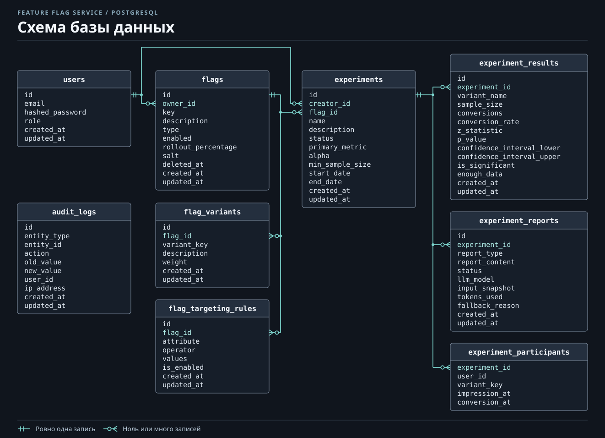

# Модель данных Feature Flag Service

PostgreSQL хранит настройки, агрегаты и историю отчётов. MongoDB хранит исходные события. `experiment_id` связывает данные между хранилищами: это UUID в PostgreSQL и строковое представление того же UUID в MongoDB.

## PostgreSQL



На схеме показаны таблицы приложения. Служебная таблица `alembic_version` хранит номер применённой ревизии миграций.

| __Таблица__                   | __Назначение и связи__                                                                                                                                                                               |
|-------------------------------|------------------------------------------------------------------------------------------------------------------------------------------------------------------------------------------------------|
| __`users`__                   | Учётные записи операторов сервиса. `email` уникален, пароль хранится как хеш. Роль задаёт уровень доступа.                                                                                           |
| __`flags`__                   | Конфигурация feature-флагов. `owner_id` ссылается на `users.id`, `key` уникален. При мягком удалении заполняется `deleted_at`, ключ остаётся зарезервированным.                                      |
| __`flag_variants`__           | Варианты флага и их веса. `flag_id` ссылается на `flags.id`, пара `(flag_id, variant_key)` уникальна.                                                                                                |
| __`flag_targeting_rules`__    | Правила таргетинга флага. `flag_id` ссылается на `flags.id`, `values` хранит JSON-массив, `is_enabled` определяет, применяется ли правило.                                                           |
| __`experiments`__             | Параметры, статус и даты эксперимента. `flag_id` ссылается на флаг, `creator_id` — на создателя в `users`. Владельцем ресурса считается владелец флага.                                              |
| __`experiment_results`__      | Последний снимок статистики. `experiment_id` ссылается на эксперимент, пара `(experiment_id, variant_name)` уникальна. Пересчёт заменяет строки этого эксперимента одной транзакцией.                |
| __`experiment_reports`__      | Задания и история отчётов по эксперименту. `experiment_id` ссылается на эксперимент, `input_snapshot` хранит входные метрики в JSONB, `report_content` — текст, когда он сформирован.                |
| __`experiment_participants`__ | Компактное состояние для пересчёта после очистки MongoDB. Составной ключ `(experiment_id, user_id, variant_key)`. Внешний ключ `experiment_id` объявлен с `ON DELETE CASCADE`.                       |
| __`audit_logs`__              | Актор, действие, тип и идентификатор сущности, состояния до и после изменения. Снимки сериализуются в текстовые поля `old_value` и `new_value`. `user_id` и `entity_id` хранятся без внешних ключей. |

### Ключевые ограничения и снимки

- Имя эксперимента уникально. Частичный уникальный индекс по `flag_id` допускает только один эксперимент в состояниях `running` или `paused` для одного флага. Условия `CHECK` ограничивают допустимые статусы, `0 < alpha < 1` и положительный `min_sample_size`, если он указан.
- Результат хранит строку на вариант. В ней находятся размер выборки, число конверсий, доля конверсии, статистики сравнения, доверительный интервал и признаки достаточности данных и значимости. `variant_name` содержит ключ варианта в момент расчёта.
- Задание отчёта хранит свой снимок отдельно от последнего результата. Новый расчёт может заменить `experiment_results`, а ранее созданное задание продолжит использовать свои метрики. Для `experiment_reports` используются статусы `pending`, `completed` и `failed`. Поля `llm_model`, `tokens_used` и `fallback_reason` описывают генерацию, когда эти данные доступны.
- Мягкое удаление флага сохраняет связанные эксперименты, результаты и отчёты. Операции конфигурации и управления ролями пишут аудит в той же транзакции PostgreSQL. Например, при смене роли в журнал попадают старая и новая роли.

## MongoDB

Сервис пишет документы в коллекцию `events` базы, указанной в `MONGO_DB`.
В HTTP-ответе `_id` MongoDB возвращается строкой в поле `id`. Ниже пример
документа конверсии в формате MongoDB Extended JSON.

```json
{
  "_id": { "$oid": "655000000000000000000001" },
  "event_type": "conversion",
  "event_name": "purchase",
  "flag_key": "checkout-demo",
  "experiment_id": "11111111-1111-4111-8111-111111111111",
  "variant_key": "B",
  "user_id": "demo-user-42",
  "value": null,
  "metadata": { "platform": "web" },
  "timestamp": { "$date": "2026-11-10T12:00:00Z" },
  "created_at": { "$date": "2026-11-10T12:00:01Z" },
  "processed": false,
  "processed_at": null
}
```

`timestamp` — время события. API нормализует его к UTC, а при отсутствии поля подставляет текущее время. `created_at` отражает время записи. `processed` и `processed_at` изменяет воркер. `user_id` обозначает участника на стороне клиента, а не оператора сервиса из PostgreSQL.

`experiment_id` и `variant_key` могут быть пустыми для событий вне эксперимента. При указанном `experiment_id` API проверяет связку с запущенным экспериментом, флагом и вариантом по данным PostgreSQL. MongoDB самостоятельно эту связь не проверяет.

### Индексы

| Поля                                           | Назначение                                                         |
|------------------------------------------------|--------------------------------------------------------------------|
| __`_id`__                                      | Встроенный индекс идентификатора документа.                        |
| __`(experiment_id, variant_key, event_type)`__ | Поиск событий эксперимента с возможным уточнением варианта и типа. |
| __`(experiment_id, timestamp)`__               | Поиск по эксперименту и выборка событий по возрасту при очистке.   |
| __`(processed)`__                              | Поиск необработанных событий.                                      |
| __`(user_id, experiment_id)`__                 | Поиск событий пользователя, в том числе в конкретном эксперименте. |

Четыре прикладных индекса создаёт `python -m src.event_indexes`. Compose выполняет эту команду в сервисе `init`.

### Срок хранения и компактное состояние

Beat запускает очистку раз в сутки. Возраст исходного документа считается по `timestamp`.

| Состояние эксперимента                   | Правило очистки                                                                                                                                                                   |
|------------------------------------------|-----------------------------------------------------------------------------------------------------------------------------------------------------------------------------------|
| __`running`, `paused`__                  | Обработанные события старше 30 дней удаляются после сохранения компактного состояния в PostgreSQL. Необработанные документы остаются в MongoDB.                                   |
| __`completed`, `stopped`__               | Исходные события старше 90 дней удаляются. Компактное состояние удаляется после 90 дней с `end_date`, если дата заполнена. Сохранённые результаты и отчёты остаются в PostgreSQL. |
| __`draft`__, нет известного эксперимента | Плановая очистка эти документы не выбирает.                                                                                                                                       |

Для каждой тройки `(experiment_id, user_id, variant_key)` компактное состояние хранит время первого показа (`impression_at`) и последней целевой конверсии (`conversion_at`). При повторной обработке объединяются минимальное время показа и максимальное время конверсии. PostgreSQL фиксирует обновление перед удалением конкретной пачки из MongoDB. Если задача оборвётся между этими операциями, повторный расчёт объединит исходные события и сохранённые отметки по тому же участнику без двойного подсчёта. Состояние позволяет пересчитать конверсии, но не содержит исходные `metadata` или хронологию всех событий.

См. [архитектуру сервиса](architecture.md) и [демонстрацию записи событий и расчёта](demo.md).
